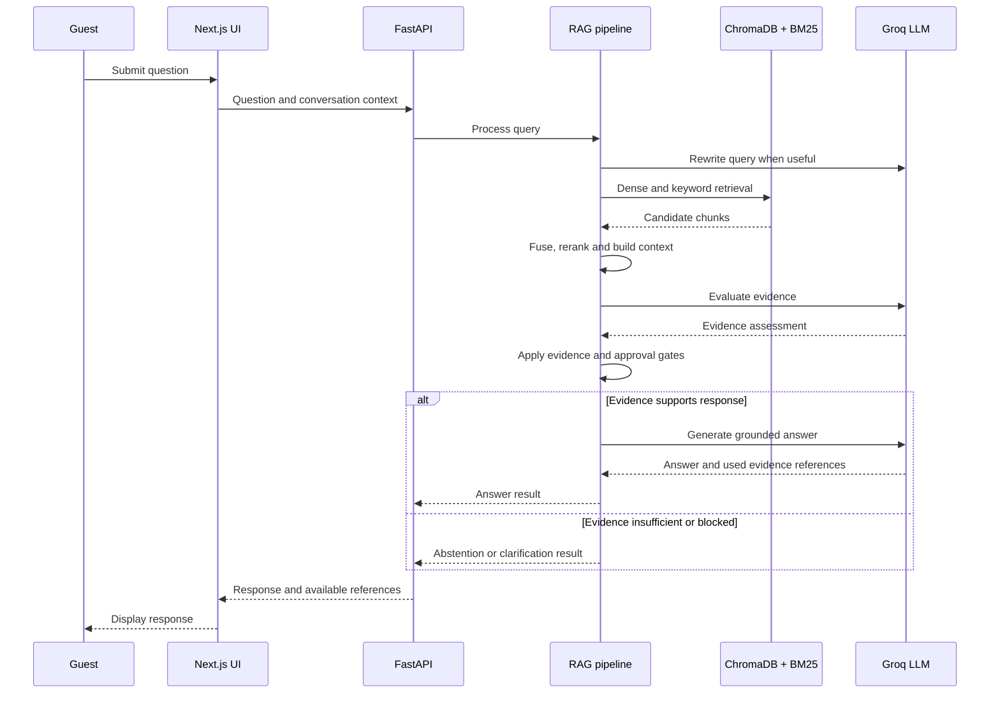

# SupportIQ — Functional Requirements Document (FRD)

**Product:** SupportIQ  
**Demo organization:** StayEase (fictional hospitality platform)  
**Version:** 1.0  
**Status:** Portfolio project baseline  
**Last updated:** 20 November 2026

---

## 1. Purpose

This document defines the functional behavior of SupportIQ's guest-facing RAG assistant and lightweight ticket workflow. It translates the product scope in the [PRD](PRD.md) into system behaviors, validation rules, data expectations and acceptance criteria.

## 2. System context

| Component | Responsibility |
|---|---|
| Next.js frontend | Guest chat, conversation display, ticket consent/form and agent ticket dashboard |
| FastAPI backend | API requests, orchestration and service access |
| RAG pipeline | Query processing, retrieval, reranking, context building, evidence evaluation and generation |
| ChromaDB | Dense vector retrieval |
| BM25 index | Keyword retrieval |
| Sentence Transformers | Embedding generation |
| Cross-Encoder | Reranking retrieved candidates |
| Groq API | LLM-based evidence evaluation and generation in current setup |
| PostgreSQL | Ticket and related application data persistence |
| Knowledge base | Synthetic policies, SOPs, articles and metadata |
| Evaluation scripts | Retrieval, evidence and generation test workflows |

### 2.1 RAG request flow



## 3. Functional requirements

### 3.1 Conversation and query intake

| ID | Requirement |
|---|---|
| FR-001 | Guest interface shall allow a guest to submit a natural-language question. |
| FR-002 | Backend shall associate messages with a conversation identifier. |
| FR-003 | Chat service shall retain relevant messages for contextual follow-ups. |
| FR-004 | System may rewrite a query to improve retrieval while preserving guest intent. |
| FR-005 | Assistant shall not claim access to an individual booking, payment or property record unless that information is explicitly available. |

**Acceptance criteria**
- Guest can submit a question and receive a response.
- A follow-up can use relevant earlier conversation context.
- A guest-specific booking question is not answered as though private booking data were available when it is not.

### 3.2 Knowledge retrieval

| ID | Requirement |
|---|---|
| FR-010 | Retrieve candidate chunks using dense vector search. |
| FR-011 | Retrieve candidate chunks using BM25 keyword search. |
| FR-012 | Combine retrieval rankings using reciprocal-rank fusion. |
| FR-013 | Rerank candidates using a cross-encoder. |
| FR-014 | Apply audience and document metadata constraints where applicable. |
| FR-015 | Retain document and chunk metadata needed for traceability. |

**Acceptance criteria**
- Retrieval returns relevant chunks for supported policy and SOP test questions.
- Candidate results can be inspected during evaluation.
- Guest-facing questions are not supported by hotel-partner-only evidence unless that content is explicitly applicable to both audiences.

### 3.3 Context building and evidence evaluation

| ID | Requirement |
|---|---|
| FR-020 | Build a bounded context from reranked, relevant chunks. |
| FR-021 | Evidence evaluator shall assess whether selected evidence supports the requested answer. |
| FR-022 | Evidence assessment shall identify evidence chunk IDs, supported facts, missing information and a reason. |
| FR-023 | Validate that evaluator-referenced chunk IDs belong to the selected context. |
| FR-024 | Prevent unapproved or missing-approval evidence from supporting generated answers. |
| FR-025 | Evidence gate shall determine whether to answer, answer partially, answer with constraints, abstain or block generation. |

**Evidence classifications**

| Classification | Meaning | Expected behavior |
|---|---|---|
| `sufficient` | Evidence supports the requested response | Generate grounded answer |
| `partial` | Evidence supports some parts but not all | Answer supported parts, disclose gaps and offer human assistance where appropriate |
| `constraint_only` | Evidence provides limitations or conditions but not an unrestricted direct answer | State supported constraints or abstain, depending on assessment |
| `insufficient` | Evidence does not support a reliable answer | Abstain and offer human assistance where appropriate |
| `unassessed` | Evidence evaluation did not produce a valid assessment | Block generation |

**Acceptance criteria**
- Generator receives only evidence permitted by evidence and approval gates.
- Invalid evaluator chunk references are rejected.
- Partial evidence does not become a complete or overconfident answer.
- If evidence evaluation fails, the system does not silently treat the result as sufficient.

### 3.4 Answer generation and response behavior

| ID | Requirement |
|---|---|
| FR-030 | Generate answers using selected evidence rather than unsupported model knowledge. |
| FR-031 | Include source references for evidence-backed responses where available. |
| FR-032 | Distinguish supported facts from missing information in partial answers. |
| FR-033 | Do not invent property-specific details, booking records, refund outcomes or guaranteed timelines. |
| FR-034 | Abstain when evidence is insufficient or generation is blocked. |
| FR-035 | Respond naturally to simple conversational questions when appropriate, without requiring every exchange to use policy retrieval. |
| FR-036 | Identify out-of-scope requests and explain limitations without pretending to execute them. |

**Acceptance criteria**
- A policy-backed question returns an answer supported by retrieved approved content.
- A partially supported question returns only the supported portion and clearly states what cannot be verified.
- An unsupported question does not receive fabricated policy details.
- Assistant does not claim to have completed a booking, refund, cancellation or payment action.

### 3.5 Human assistance and ticket consent

| ID | Requirement |
|---|---|
| FR-040 | When human investigation is appropriate, assistant shall offer human assistance. |
| FR-041 | Ask the guest whether they want to create a ticket before displaying the ticket form. |
| FR-042 | If guest declines, dismiss the offer and create no ticket. |
| FR-043 | If guest agrees, display the ticket form. |
| FR-044 | Form shall collect guest email if not already available, issue title and issue description. |
| FR-045 | Guest shall explicitly consent to ticket submission. |
| FR-046 | Backend shall reject ticket creation if consent is absent or false. |
| FR-047 | Create at most one ticket per conversation. |
| FR-048 | Ticket shall retain the relevant conversation transcript. |
| FR-049 | After successful creation, show the guest a ticket reference and confirmation. |
| FR-050 | Do not promise an unconfigured response SLA or guaranteed resolution time. |

**Acceptance criteria**
- No ticket form is displayed before the guest agrees.
- Selecting No does not call the ticket-creation endpoint.
- Ticket creation requires explicit consent.
- Repeated submissions for the same conversation do not create multiple tickets.
- Successful creation displays the returned ticket reference.
- Failed creation does not display a false success message.

### 3.6 Ticket dashboard and agent workflow

| ID | Requirement |
|---|---|
| FR-060 | Dashboard shall display available tickets. |
| FR-061 | Agent shall be able to inspect an individual ticket and its relevant conversation transcript. |
| FR-062 | Agent shall be able to update a ticket's basic status. |
| FR-063 | Supported statuses shall be `Open`, `In Progress` and `Resolved`. |
| FR-064 | Agent follow-up shall occur by email outside SupportIQ chat. |
| FR-065 | Dashboard shall not imply live agent chat, automated assignment or complex workload management. |

**Acceptance criteria**
- Dashboard retrieves and displays tickets.
- A ticket can be opened for detail review.
- Status changes persist and are reflected in the dashboard.
- No live chat or automated routing is represented as implemented.

## 4. Ticket data requirements

### 4.1 Ticket fields

| Field | Purpose |
|---|---|
| `ticket_id` | Unique ticket reference |
| `conversation_id` | Originating conversation; enforces one-ticket-per-conversation behavior |
| `guest_email` | Guest contact address for follow-up |
| `issue` | Short issue title/category text |
| `issue_description` | Guest's description |
| `conversation_transcript` | Relevant messages from the originating conversation |
| `created_at` | Ticket creation timestamp |
| `status` | `Open`, `In Progress` or `Resolved` |
| `agent_response_reference` | Optional reference/metadata for an agent email response |

### 4.2 Validation rules

- `conversation_id` is required.
- `guest_email` is required before submission.
- `issue` and `issue_description` are required.
- Consent must be explicitly true.
- A conversation may have zero or one ticket.
- A duplicate ticket attempt must be rejected or return the existing ticket according to service behavior.
- Ticket status must be one of the supported values.

## 5. API behavior

The current ticket API routes are:

| Method | Endpoint | Behavior |
|---|---|---|
| `POST` | `/tickets/create` | Validate request and consent, prevent duplicate conversation tickets, create ticket |
| `GET` | `/tickets/` | Return tickets for dashboard |
| `GET` | `/tickets/{ticket_id}` | Return one ticket by reference |
| `PATCH` | `/tickets/{ticket_id}/status` | Validate and persist a basic status update |

The chat API is implemented separately under backend chat routes. Refer to current FastAPI route definitions and interactive API documentation for its exact path and request schema.

### 5.1 Illustrative ticket creation request

```json
{
  "conversation_id": "conversation-reference",
  "guest_email": "guest@example.com",
  "issue": "Duplicate payment",
  "issue_description": "I appear to have been charged twice for one reservation.",
  "conversation_transcript": [
    {"role": "user", "content": "I was charged twice."},
    {"role": "assistant", "content": "I can help arrange human assistance."}
  ],
  "consent": true
}
```

This is an illustrative request shape. The backend schema is the implementation source of truth.

## 6. Error and fallback behavior

| Scenario | Expected behavior |
|---|---|
| No relevant chunks retrieved | Do not invent an answer; abstain or clarify |
| Evidence evaluator returns invalid output | Block generation |
| Evidence references unknown chunk IDs | Reject assessment |
| Selected evidence is not approved | Do not use it to generate an answer |
| LLM provider unavailable | Return safe error/fallback; do not fabricate |
| Guest declines ticket | Dismiss; do not create ticket |
| Consent missing or false | Reject ticket creation |
| Duplicate ticket for conversation | Prevent a second ticket |
| Ticket not found | Return not-found response |
| Invalid status | Reject status update |

## 7. Security and privacy

- API keys, database credentials and environment files must not be committed.
- Frontend public environment variables must not contain secrets.
- Ticket and transcript data must be accessible only through the intended application workflow.
- Do not log secrets or unnecessary personal information.
- Do not populate the demo with real guest personal data.
- Synthetic StayEase documents must be clearly distinguished from real operational policy.

## 8. Observability and evaluation

The implementation should support inspection of:
- Retrieved candidates and ranking.
- Final selected context.
- Evidence classification, supported facts and missing information.
- Approval-gate decision.
- Generated answer and cited chunk IDs.
- Ticket creation result and status transitions.
- End-to-end latency and model usage where available.

Evaluation should include answerable, partially answerable, unsupported, wrong-audience, ambiguous and out-of-scope questions, as well as ticket consent and duplicate-creation cases.

## 9. Out of scope

- Live agent-to-guest chat.
- Automatic email sending or email-provider integration.
- Booking, payment, cancellation or refund execution.
- PMS or CRM integration.
- Automatic department routing or agent assignment.
- Complex SLA, escalation or workload management.
- Agent performance analytics.

## 10. End-to-end acceptance scenarios

### Scenario A — Supported question
**Given** an approved policy contains the answer,  
**When** the guest asks a question covered by that policy,  
**Then** SupportIQ retrieves relevant evidence and returns a grounded answer with source references where available.

### Scenario B — Partially supported question
**Given** evidence supports only part of the question,  
**When** the evaluator classifies the result as partial,  
**Then** SupportIQ answers the supported portion and identifies missing information without inventing the rest.

### Scenario C — Insufficient evidence
**Given** the knowledge base does not support the requested answer,  
**When** evidence evaluation returns insufficient,  
**Then** SupportIQ abstains and may offer human assistance.

### Scenario D — Guest declines ticket
**Given** SupportIQ offers ticket creation,  
**When** the guest selects No,  
**Then** the form is dismissed and no ticket is created.

### Scenario E — Guest consents to ticket
**Given** the guest selects Yes and completes required details,  
**When** the guest explicitly consents and submits,  
**Then** the backend creates one ticket and returns its reference.

### Scenario F — Duplicate ticket prevention
**Given** a ticket already exists for a conversation,  
**When** another creation request is submitted for the same conversation,  
**Then** the system prevents a second ticket.

### Scenario G — Agent status update
**Given** a ticket exists,  
**When** an agent changes its status to a supported value,  
**Then** the new status is persisted and displayed.

## 11. Open implementation checks

Confirm these against the running application before treating the FRD as fully implementation-verified:
- Exact chat endpoint and request/response schema.
- Exact frontend display behavior for citations and evidence references.
- Exact database constraints and duplicate-ticket response behavior.
- Whether email follow-up is manual or uses a separately configured email service.
- Production authentication and authorization for agent dashboard access.
