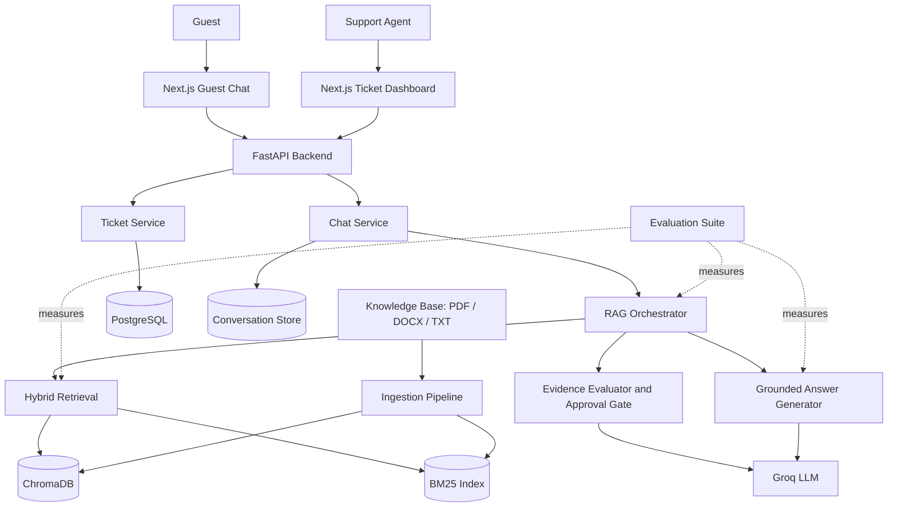
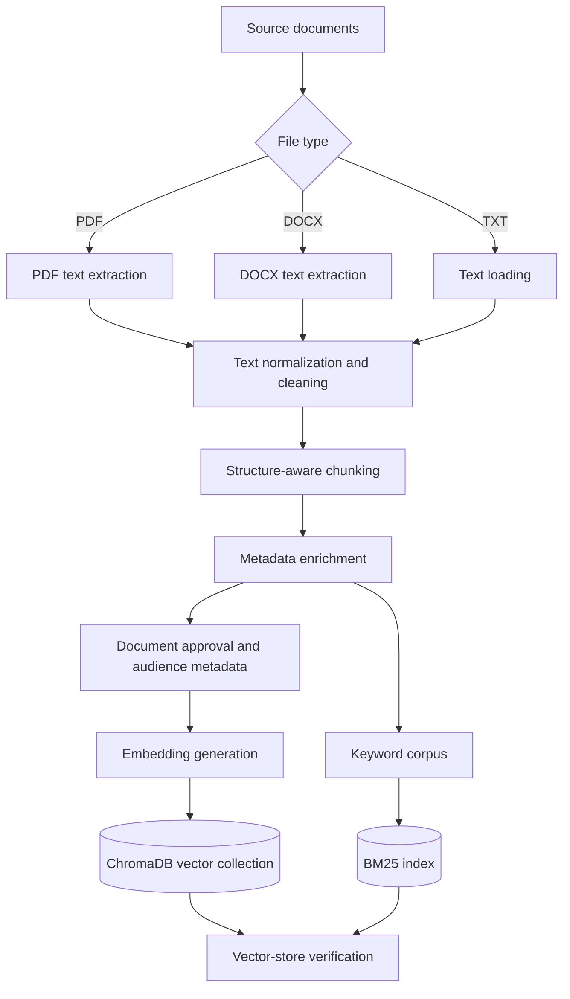
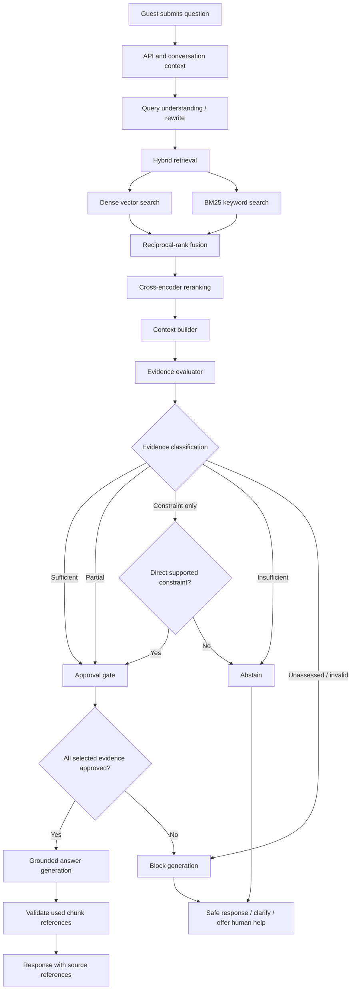
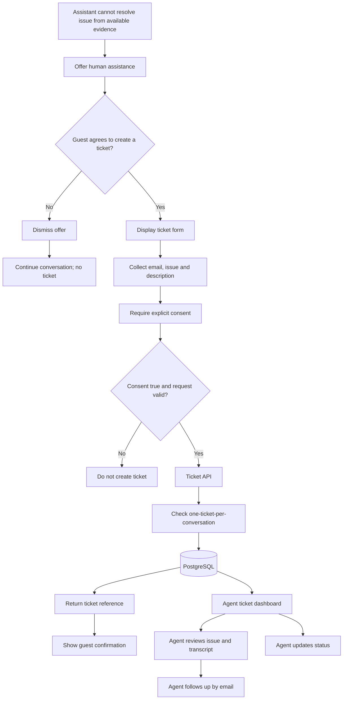
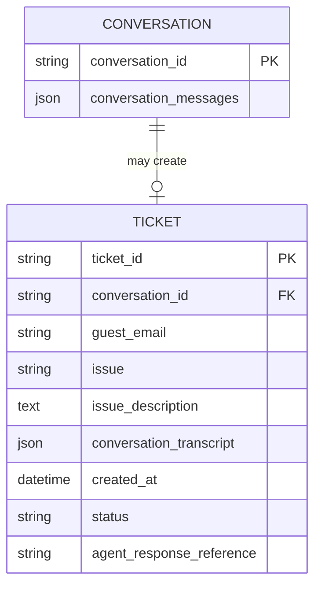
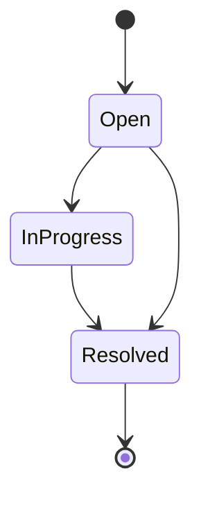
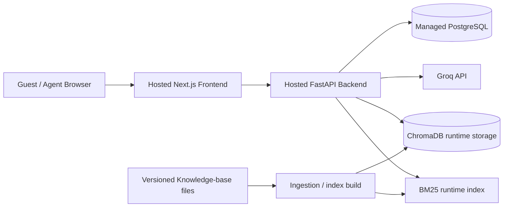

# SupportIQ — System Architecture

**Product:** SupportIQ  
**Demo organization:** StayEase (fictional hospitality platform)  
**Version:** 1.0  
**Status:** Portfolio architecture baseline  
**Last updated:** 20 November 2026

---

## 1. Purpose and architecture overview

SupportIQ is a RAG-powered hospitality support assistant with a lightweight ticket fallback. Its architecture separates document ingestion, online question answering, evidence controls, persistence and evaluation.

The primary runtime path answers guest questions using synthetic approved policies, SOPs and knowledge articles. A secondary path creates a ticket only when human investigation is appropriate and the guest explicitly agrees.

The architecture is designed around one core principle:

> **Retrieve first, assess evidence, then generate. If evidence is not sufficient, do not invent an answer.**

StayEase is fictional. All knowledge-base content in this portfolio demo is synthetic and is not real operational policy.

## 2. High-level system context

### Main architectural layers

| Layer | Responsibility |
|---|---|
| Presentation | Guest chat and internal ticket dashboard |
| API and application services | Request validation, conversation handling and ticket operations |
| RAG orchestration | Coordinates query rewriting, retrieval, ranking, context, evidence assessment and generation |
| Retrieval | Dense vector search, BM25 keyword search, fusion and reranking |
| Knowledge and indexes | Synthetic source documents, metadata, chunks, ChromaDB and BM25 index |
| Persistence | Conversations and tickets |
| LLM integration | Query/evidence tasks and grounded response generation |
| Evaluation and observability | Test retrieval, evidence decisions, answer quality, ticket behavior, latency and usage |

## 3. Knowledge-base ingestion architecture

Ingestion is an offline or controlled administrative workflow. It prepares source documents for retrieval; it is not run from scratch for every guest question.

### Ingestion stages

1. **Load:** Read PDF, DOCX and TXT source files.
2. **Extract:** Extract text while retaining useful document structure.
3. **Normalize:** Clean extraction artifacts and standardize content.
4. **Chunk:** Split content into retrieval-sized chunks while respecting document structure where possible.
5. **Enrich:** Attach identifiers and metadata such as document ID, chunk ID, audience, document type and approval status.
6. **Embed:** Generate dense vectors using the configured Sentence Transformers model.
7. **Index:** Store vectors and metadata in ChromaDB; prepare the keyword corpus for BM25 retrieval.
8. **Verify:** Check document coverage, approval metadata and index integrity.

### Current demo knowledge base

The initial synthetic StayEase knowledge base contains 27 source documents:

| Type | Count |
|---|---:|
| Guest policy PDFs | 8 |
| Hotel-partner policy PDFs | 6 |
| SOP DOCX files | 8 |
| Knowledge article TXT files | 5 |
| **Total** | **27** |

The previously verified local vector store contained 141 chunks. This is a development verification result and may change when documents, chunking rules or embeddings change.

## 4. Online RAG question-answering architecture

### 4.1 Request intake and conversation context

- The guest submits a question through the Next.js chat interface.
- The backend associates the request with a conversation identifier.
- Relevant prior messages may be used to interpret follow-up questions.
- Query rewriting may make a question more retrieval-friendly while preserving its intent.

### 4.2 Hybrid retrieval

SupportIQ combines two retrieval methods:

- **Dense retrieval:** Semantic similarity search over embeddings in ChromaDB.
- **Keyword retrieval:** BM25 matching for important terms, identifiers and exact phrases.

The retrieval lists are combined using reciprocal-rank fusion (RRF). A cross-encoder then reranks the candidate chunks for relevance to the current question.

### 4.3 Context building

The context builder selects a bounded set of relevant chunks and applies applicable audience filtering and deduplication. Each chunk retains metadata required for traceability.

### 4.4 Evidence evaluation

The evidence evaluator assesses whether the selected context supports the question. Its assessment includes:
- Classification.
- Evidence chunk IDs.
- Supported facts.
- Missing information.
- Explanation of the decision.

The evaluator's chunk references must be validated against the selected context. Evidence evaluation is a decision aid, not proof that a generated sentence is factually correct; generated answers still require evaluation.

### 4.5 Evidence and approval gate

The evidence gate controls whether generation may proceed:

| Classification | Intended decision |
|---|---|
| `sufficient` | Generate an answer from supported evidence |
| `partial` | Generate only supported portions and disclose missing information |
| `constraint_only` | State supported constraints only when a direct constrained answer is justified; otherwise abstain |
| `insufficient` | Abstain and offer human assistance where appropriate |
| `unassessed` | Block generation |

A separate approval check ensures that selected evidence is approved before it can support an answer. If the assessment is invalid or evidence is not approved, generation is blocked.

### 4.6 Grounded answer generation

- The generator receives only the evidence permitted by the evaluator and approval gate.
- The answer should not add unsupported property-specific or guest-specific facts.
- For partial evidence, it should answer supported parts and state what cannot be verified.
- Source references should correspond to known selected chunks.
- If evidence cannot support a reliable answer, the assistant should abstain or seek clarification rather than fabricate.

## 5. Evidence decision and human-support branch

The ticket workflow is separate from normal answer generation. It is a fallback for cases that need investigation, not a replacement for the RAG assistant.

### Ticket behavior

1. Assistant offers human assistance when appropriate.
2. Guest must choose whether to proceed.
3. If the guest declines, the offer is dismissed and no ticket is created.
4. If the guest agrees, the frontend displays the ticket form.
5. Required details include guest email, issue title and issue description.
6. Explicit consent is required before submission.
7. Backend validates consent and prevents more than one ticket for a conversation.
8. Ticket and relevant conversation transcript are stored.
9. Guest receives a ticket reference.
10. Agent reviews the ticket in the dashboard and follows up by email, outside chat.

### Ticket data model

The one-to-zero-or-one relationship means a conversation can have no ticket or one ticket, but not multiple tickets.

### Ticket status lifecycle

Supported statuses are `Open`, `In Progress` and `Resolved`. This is intentionally a basic status lifecycle, not a complex SLA or escalation engine.

## 6. API and service boundaries

### Chat path

The chat API accepts a guest message and conversation context, delegates processing to the chat service and RAG pipeline, and returns the assistant response. Exact chat request/response fields should be read from the current backend route and schema implementation.

### Ticket paths

| Method | Endpoint | Responsibility |
|---|---|---|
| `POST` | `/tickets/create` | Validate and create a ticket |
| `GET` | `/tickets/` | List tickets for dashboard |
| `GET` | `/tickets/{ticket_id}` | Retrieve ticket detail |
| `PATCH` | `/tickets/{ticket_id}/status` | Update basic ticket status |

### Responsibility separation

- **Chat service:** Conversation handling and RAG invocation.
- **RAG pipeline:** Retrieval, reranking, context construction, evidence evaluation, gating and generation.
- **Ticket service:** Ticket validation, duplicate prevention and persistence.
- **Frontend:** User interaction and display; it must not bypass backend consent validation.

## 7. Data stores

| Store | Data | Purpose |
|---|---|---|
| Source knowledge base | PDF, DOCX, TXT and metadata registry | Human-readable source of truth for the demo |
| ChromaDB | Chunk embeddings and retrieval metadata | Dense semantic retrieval |
| BM25 index | Tokenized chunk corpus | Keyword retrieval |
| PostgreSQL | Tickets and related application records | Persistent ticket workflow |
| Conversation store | Conversation messages/context | Follow-up continuity |

Generated vector-store files are local or deployment runtime artifacts. They should not be committed as source code. The index should be rebuilt or provisioned through the ingestion process in the target environment.

## 8. Technology mapping

| Concern | Current technology |
|---|---|
| Guest and agent UI | Next.js, React, TypeScript, Tailwind CSS |
| API | FastAPI and Uvicorn |
| Embeddings | Sentence Transformers |
| Vector store | ChromaDB |
| Keyword search | `rank-bm25` |
| Reranking | `cross-encoder/ms-marco-MiniLM-L-6-v2` |
| LLM provider | Groq API; current development model `openai/gpt-oss-20b` |
| Relational persistence | PostgreSQL |
| Document extraction | PyMuPDF and python-docx |
| Evaluation | Python test modules and evaluation scripts |

Provider/model names are configuration details and may change without changing the high-level architecture.

## 9. Failure handling and safe defaults

| Failure | Safe behavior |
|---|---|
| No relevant retrieval results | Abstain or ask for clarification |
| Wrong-audience evidence | Filter or reject evidence that is not applicable |
| Evidence evaluator invalid/unavailable | Block generation |
| Evidence references unknown chunks | Reject assessment |
| Unapproved evidence | Do not use for answer generation |
| LLM provider unavailable | Return safe error/fallback; do not invent a response |
| Guest declines ticket | Dismiss; do not create ticket |
| Consent missing/false | Reject ticket creation |
| Duplicate ticket | Prevent second ticket for conversation |
| Ticket lookup fails | Return an appropriate error; do not show false data |

## 10. Security, privacy and trust boundaries

- Keep API keys, database passwords and environment files outside source control.
- Do not place secrets in `NEXT_PUBLIC_*` variables.
- Validate ticket consent on the backend, not only in the UI.
- Restrict ticket and transcript access to the intended agent workflow.
- Avoid logging secrets and unnecessary personal information.
- Use synthetic guest data for portfolio demonstrations.
- Treat retrieved document content as data, not executable instructions.
- Do not treat a document's demo approval flag as real-world operational authorization.

## 11. Evaluation and observability

Evaluate the architecture at component and end-to-end levels:

| Area | Example checks |
|---|---|
| Ingestion | Document coverage, extraction quality, chunk metadata and approval status |
| Retrieval | Recall@k, Precision@k, MRR/nDCG and audience correctness |
| Reranking | Whether relevant chunks move into the final context |
| Evidence evaluation | Classification accuracy and valid evidence references |
| Generation | Claim groundedness, completeness and partial-answer behavior |
| Citations | Source reference correctness |
| Safety | Unsupported-answer rate and appropriate abstention |
| Ticketing | Consent enforcement, duplicate prevention and status persistence |
| Operations | Latency, provider errors and token/cost usage |

## 12. Deployment topology

A typical hosted topology separates the frontend, backend and managed database:

The exact hosting providers and persistence approach are deployment decisions. If the backend host has ephemeral storage, the vector index must be rebuilt at deploy/startup or stored in an appropriate persistent service/volume. Do not assume local ChromaDB files survive a redeploy.

## 13. Architecture decisions and rationale

| Decision | Rationale |
|---|---|
| Hybrid dense + keyword retrieval | Combines semantic matching with exact terminology and identifiers |
| RRF before reranking | Merges independent retrieval rankings before a more expensive relevance model |
| Evidence evaluation before generation | Reduces unsupported answer generation |
| Separate approval gate | Prevents unapproved content from becoming answer evidence |
| Partial answers | Preserves useful supported information while exposing gaps |
| Lightweight ticket fallback | Provides human investigation without building a full helpdesk |
| One ticket per conversation | Keeps the ticket relationship simple and prevents duplicate submissions |
| Email follow-up outside chat | Avoids implying live-agent messaging capability |

## 14. Known limitations and implementation verification

This architecture describes the current intended design and portfolio implementation. Verify these details against the deployed code before treating the document as an operational runbook:

- Exact chat API schema and endpoint.
- Exact persistence behavior for conversation memory.
- Whether BM25 index is rebuilt at process startup or persisted.
- Production persistence strategy for ChromaDB.
- Authentication and authorization for the agent dashboard.
- Email follow-up is manual unless a separate email integration is implemented.
- Production monitoring, backups, rate limiting and retention controls are not implied by this portfolio architecture.
