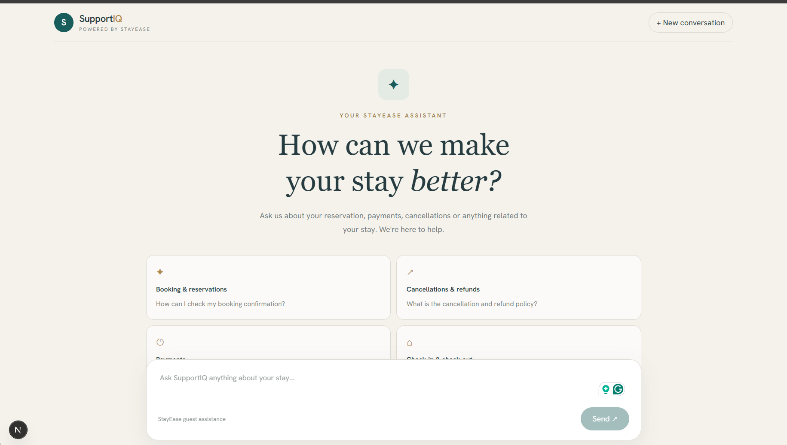
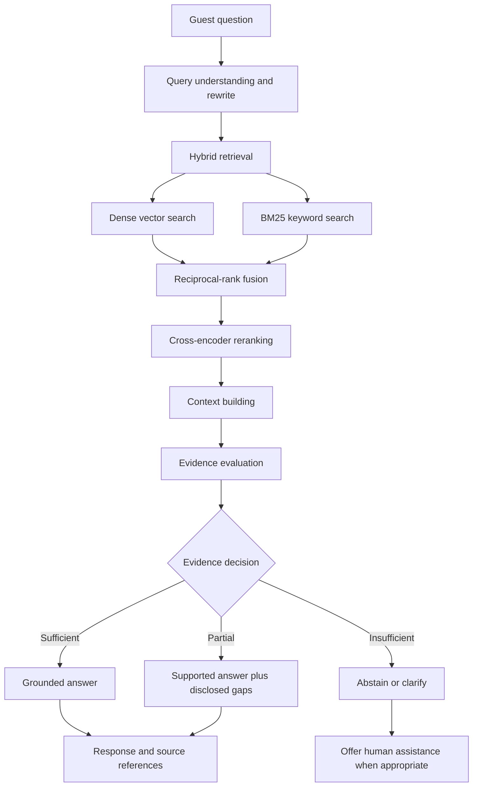
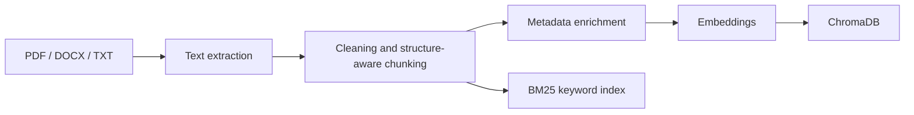
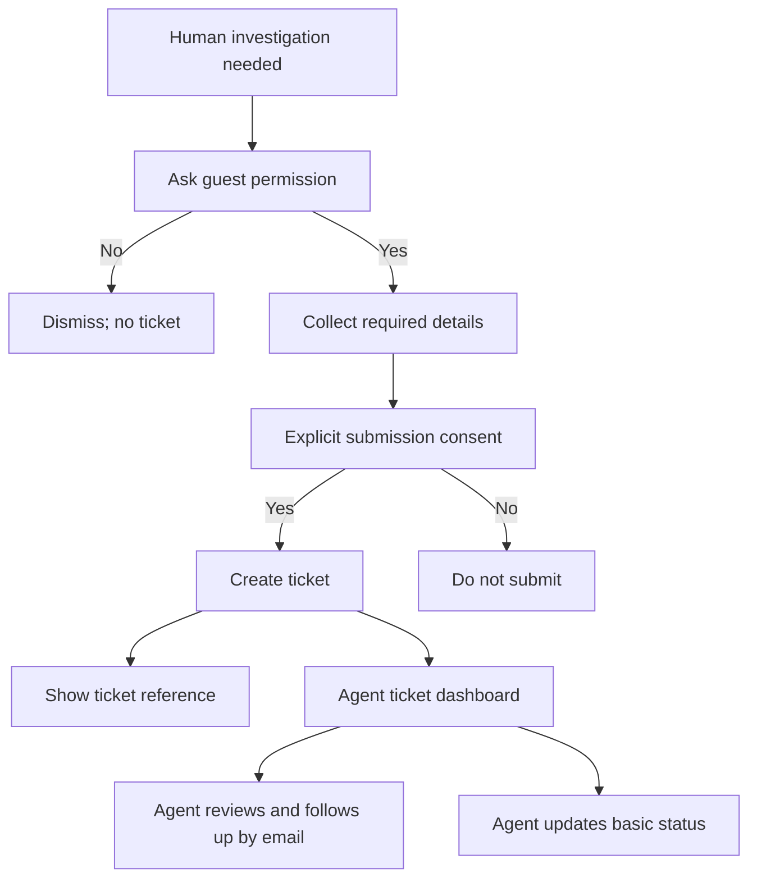

<div align="center">

# SupportIQ
### Evidence-grounded AI support for hospitality

A RAG-powered guest assistance copilot that answers hospitality questions using approved policies, SOPs and knowledge articles—with a lightweight human-support ticket fallback.

[Product Requirements](docs/PRD.md) · [Functional Requirements](docs/FRD.md) · [System Architecture](docs/SYSTEM_ARCHITECTURE.md)

</div>

---

## Contents
- [Overview](#overview)
- [Problem](#problem)
- [Capabilities](#capabilities)
- [Screenshots](#screenshots)
- [Architecture](#architecture)
- [Technology stack](#technology-stack)
- [Repository structure](#repository-structure)
- [Run locally](#run-locally)
- [Ticket API](#ticket-api)
- [Evaluation](#evaluation)
- [Documentation](#documentation)
- [Scope boundaries](#scope-boundaries)

## Overview

**SupportIQ** is a portfolio project demonstrating a retrieval-augmented generation (RAG) assistant for hospitality support. It uses a fictional hospitality platform, **StayEase**, and a synthetic knowledge base.

The assistant retrieves relevant content, evaluates whether the evidence supports an answer, and responds with a complete answer, a partial answer, a clarification or an abstention. When a question needs human investigation, the assistant can offer a lightweight ticket workflow—with guest permission.

> **Demo disclaimer:** StayEase and its policies are fictional. The knowledge-base documents are synthetic and intended for demonstration and evaluation, not real hotel operations.

## Problem

Hospitality guests ask recurring questions about reservations, cancellations, refunds, payments, check-in/check-out and stay experiences. A generative assistant that answers without reliable evidence can mislead guests. SupportIQ explores an evidence-first approach: retrieve approved source material, assess its relevance and sufficiency, and avoid presenting unsupported claims as facts.

## Capabilities

| Capability | Description |
|---|---|
| Guest question answering | Answers hospitality questions from the synthetic StayEase knowledge base |
| Hybrid retrieval | Combines dense vector search and BM25 keyword search |
| Ranking | Uses reciprocal-rank fusion and cross-encoder reranking |
| Evidence evaluation | Assesses sufficient, partial, constraint-only and insufficient evidence |
| Grounded responses | Generates answers from selected approved evidence |
| Safe abstention | Avoids inventing details when evidence is insufficient |
| Conversation context | Supports relevant follow-up questions |
| Human-support fallback | Offers ticket creation when human investigation is needed |
| Consent-based ticketing | Asks permission before the form and requires consent before submission |
| Ticket dashboard | Lets agents inspect tickets and update basic status |

## Screenshots

Screenshots below were captured from the running SupportIQ application.

| Guest chatbot | Ticket dashboard |
|---|---|
|  |  |

Suggested additional screenshots:
- `ticket-consent.png` — Yes/No permission prompt.
- `ticket-confirmation.png` — ticket reference after successful creation.
- `evidence-answer.png` — example of an evidence-backed answer.

*The image files above are placeholders for actual application screenshots. Do not use illustrative mockups as product evidence.*

## Architecture

### RAG query flow



### Knowledge ingestion



### Human-support ticket flow



## Technology stack

| Layer | Technology |
|---|---|
| Frontend | Next.js, React, TypeScript, Tailwind CSS |
| Backend | Python, FastAPI, Uvicorn |
| LLM | Groq API (`openai/gpt-oss-20b` in the current development setup) |
| Embeddings | Sentence Transformers |
| Vector retrieval | ChromaDB |
| Keyword retrieval | BM25 (`rank-bm25`) |
| Reranking | Cross-Encoder (`cross-encoder/ms-marco-MiniLM-L-6-v2`) |
| Database | PostgreSQL |
| Document processing | PyMuPDF, python-docx |
| Evaluation | Python test cases and evaluation scripts |

## Repository structure

```text
SupportIQ/
├── backend/
│   ├── app/
│   │   ├── api/          # FastAPI routes
│   │   ├── core/         # Configuration and database setup
│   │   ├── memory/       # Conversation storage
│   │   ├── rag/          # Retrieval, evidence and generation
│   │   ├── schemas/      # Request/response schemas
│   │   └── services/     # Chat and ticket services
│   └── main.py
├── frontend/
│   └── src/app/          # Next.js pages and styles
├── knowledge_base/
│   ├── Guest_Policies/
│   ├── Hotel_Partner_Policies/
│   ├── Knowledge_Articles/
│   ├── Metadata/
│   └── SOPs/
├── evaluation/
├── docs/
│   ├── PRD.md
│   └── FRD.md
├── assets/
│   └── screenshots/
└── README.md
```

## Run locally

### Prerequisites
- Python 3.12
- Node.js and npm
- PostgreSQL
- Groq API key
- Git

### 1. Clone

```bash
git clone https://github.com/pratiksha27012000-hub/SupportIQ.git
cd SupportIQ
```

### 2. Configure environment

Create a root `.env` for backend settings and `frontend/.env.local` for the frontend API URL.

Frontend example:

```env
NEXT_PUBLIC_API_URL=http://127.0.0.1:8000
```

Configure the backend variables expected by `backend/app/core/config.py`, including the LLM key and database connection settings. Use your own local values.

**Never commit `.env`, `.env.local`, API keys, passwords or production credentials.** If you add `.env.example`, use safe placeholders only.

### 3. Python environment

```powershell
py -3.12 -m venv .venv
.\.venv\Scripts\Activate.ps1
pip install -r requirements.txt
```

If the repository does not yet contain a root `requirements.txt`, create it from the backend's actual dependencies before using this command.

### 4. Start backend

From the repository root:

```bash
python -m uvicorn backend.main:app --reload
```

API: `http://127.0.0.1:8000`  
Interactive API docs: `http://127.0.0.1:8000/docs`

### 5. Start frontend

In a second terminal:

```bash
cd frontend
npm install
npm run dev
```

Open `http://localhost:3000`.

### 6. Build the knowledge index

The vector store is generated by the ingestion workflow in `backend/app/`. Follow the current ingestion scripts and configuration to build the local index. Generated ChromaDB files are local runtime data and should not be committed.

> These are setup guidelines. Verify dependency files, environment-variable names and database setup against the current code before deployment.

## Ticket API

| Method | Endpoint | Purpose |
|---|---|---|
| `POST` | `/tickets/create` | Create a ticket after required details and consent |
| `GET` | `/tickets/` | Retrieve tickets for the dashboard |
| `GET` | `/tickets/{ticket_id}` | Retrieve one ticket |
| `PATCH` | `/tickets/{ticket_id}/status` | Update basic ticket status |

Statuses: `Open`, `In Progress`, `Resolved`.

A conversation can have at most one ticket. The ticket stores the issue and relevant conversation transcript. Agent follow-up is by email, not live chat.

## Evaluation

Evaluate the system at multiple stages:
- Retrieval relevance (Recall@k, Precision@k, MRR or nDCG).
- Evidence classification across sufficient, partial, constraint-only and insufficient cases.
- Groundedness of generated claims.
- Citation correctness and source traceability.
- Unsupported-answer and appropriate-abstention rates.
- Ticket consent, duplicate prevention and lifecycle behavior.
- Latency and model usage/cost.

Evaluation scripts and test cases live in `evaluation/` and `backend/`. Development tests are not a claim of production-grade accuracy.

## Documentation

- [Product Requirements Document](docs/PRD.md)
- [Functional Requirements Document](docs/FRD.md)
- [System Architecture](docs/SYSTEM_ARCHITECTURE.md)

## Scope boundaries

**In scope:** guest-facing hospitality Q&A, approved knowledge retrieval, evidence-grounded answers, partial answers, clarification, abstention, contextual follow-ups, consent-based ticket creation and a simple ticket dashboard.

**Out of scope:** full CRM/helpdesk, live agent chat, booking/payment/refund execution, PMS/CRM integrations, automated department routing, complex SLA/escalation/workload management and autonomous operational actions.

## Disclaimer

SupportIQ is an independent portfolio project. StayEase is fictional. Policies, SOPs and knowledge articles are synthetic demonstration content and must not be treated as real hospitality operating policy.
